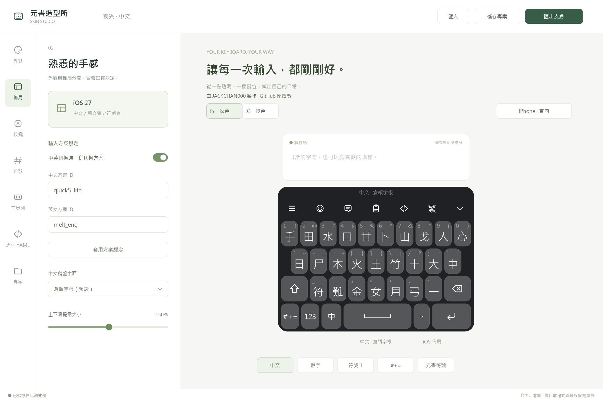
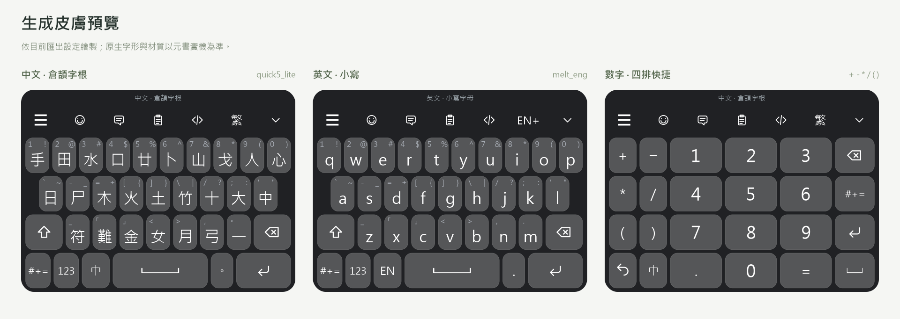

# 元書造型所 Hamster Skin Studio

作者：[JACKCHAN000](https://github.com/JACKCHAN000) · [線上使用](https://JACKCHAN000.github.io/-rime-hamster-ios-skin-designer/) · [原始碼](https://github.com/JACKCHAN000/-rime-hamster-ios-skin-designer)

元書輸入法的網頁皮膚編輯器，介面使用繁體中文，適用不同中文 RIME 輸入方案。中文預設顯示倉頡字根，可改為大寫或小寫字母，搭配仿 iOS 佈局與半透明玻璃質感。

英文鍵盤獨立處理：預設小寫，Shift 一次大寫、雙按鎖定大寫。中文的大寫字面只影響中文鍵盤。預設次主題色為淺藍色 `#B8DFFF`，用於候選字、長按選中及強調鍵；中英切換鍵保持普通鍵帽與文字色，沒有特殊藍框。

工具列 `☰` 的 50% 放大僅用於 iPhone 原生皮膚（27 pt），補償裝置上的字形大小；網頁預覽及預覽 PNG 維持原本 18 px。

## 畫面預覽

### 網頁編輯器



依目前程式與預設設定繪製的介面示意圖，展示方案綁定、倉頡字根與鍵盤預覽，並非瀏覽器實際截圖。

### 生成皮膚



由目前匯出設定繪製：中文 `quick5_lite`、英文 `melt_eng` 及四排數字鍵盤。原生字形、材質與實際效果以元書裝置為準。

## 啟動

需要 Node.js 22.12+（本次環境為 22.14.0）。首次使用：

```powershell
npm.cmd install
npm.cmd run dev
```

瀏覽器開啟 `http://127.0.0.1:4317/`。套件已安裝時，也可執行 [start-studio.cmd](start-studio.cmd)。按 Ctrl+C 停止伺服器。

所有編輯與檔案處理均在本機／瀏覽器進行，沒有帳號或雲端後端。草稿保存在目前瀏覽器；移至其他裝置前請下載專案檔。

## 功能

- Liquid Glass、霧面、實色三種外觀；深淺色獨立配色、透明度、圓角、陰影、字級、鍵距與直橫向尺寸。
- iOS 佈局，支援逐鍵編輯；切換外觀不改送鍵。
- 中文鍵面與 RIME 動作分離；預設精簡配置只在字母鍵顯示數字／標點，第三排為單向提示。句號另有隱藏的上下滑 RIME `/` 快捷，其他功能鍵不預設上下滑；可逐鍵指定快捷指令、符號、RIME 送鍵、鍵盤或腳本。
- 預設底列依序為「符號、數字、中英、空白、句號、Enter」。句號長按選擇 `， 。 , . ! ?`，另有獨立數字鍵盤。
- 鍵面依可辨識性混用文字與圖示：繁簡為「繁／簡」，空白為 `␣`（U+2423）、中英切換以「中／EN」及不同底色顯示當前狀態；返回中文與 Enter 用不同圖示。滑動提示預設為文字／符號，滑鼠提示及無障礙名稱保留繁中。
- 繁中及英文各有兩頁仿 iOS 符號；單擊／長按符號入口可分開指定。
- 工具列：`☰` 菜單 → Emoji → 常用語 → 剪貼簿 → 腳本 → 繁簡 → 收起。英文鍵盤的繁簡位置改為 ASCII 開關：EN+ 可開啟 ascii_mode，EN- 可關閉；切換不改目前英文鍵盤或 Caps Lock。收起使用單純向下箭頭，工具圖示統一字級、字重及顯示框。
- 可綁定中文／英文輸入方案，預設啟用中文 `quick5_lite`、英文 `melt_eng`；中英鍵先切換鍵盤，再切換對應 RIME 方案。
- 本機自動儲存、模板庫、復原／重做、專案 JSON 匯入與匯出。
- `.cskin` 匯出含 41 份鍵盤／設定 YAML、空白符號的 PNG 圖集與描述、預覽 PNG、說明及完整專案；有裝置映射、樣式與資源缺檔檢查。
- 原生 YAML 編輯，支援錨點與合併；原生皮膚匯入保留映射、資源與原文。可選取 `config.yaml` 編輯。
- Ryan 設定可辨識並轉換基本欄位，未轉換資料保存在專案並列出警示。

## 關聯專案

本工具負責鍵盤外觀與 `.cskin` 匯出；輸入方案、詞庫與語法模型可參考以下專案。

| 專案 | 平台／用途 | 主要內容 |
| --- | --- | --- |
| [Rime-Quick5-Setup](https://github.com/JACKCHAN000/Rime-Quick5-Setup) | 桌面 Rime，例如小狼毫／鼠鬚管 | 繁中與粵語詞庫、語法模型、中英混輸及 Lua 擴充。 |
| [Rime-Quick5-Setup-iOS](https://github.com/JACKCHAN000/Rime-Quick5-Setup-iOS) | iOS 元書／Hamster | `quick5_lite` 與 `melt_eng`、粵語語法模型及上屏聯想。 |

搭配 iOS 專案使用時，先在元書安裝及部署所需輸入方案，再匯入本工具產生的皮膚。本編輯器預設綁定 `quick5_lite`／`melt_eng`，也可在「佈局 → 輸入方案綁定」改用其他方案。

## 操作

點選預覽按鍵可編輯；「按鍵」分頁的上滑、下滑表單有常用快捷指令選單。選好後按該方向的「套用」，也可停用或還原預設。開啟「試打」後才執行一般鍵盤按鍵，字元送到上方試打紙。

「佈局 → 中文鍵盤字面」可選倉頡字根（預設）、大寫 A–Z 或小寫 a–z。字根依 RIME 倉頡對映，X 為「難」、Z 為「符」；只改顯示，仍送原字母鍵值，英文大小寫獨立處理。舊版大寫預設會升級為字根，逐鍵自訂字面保留。

符號入口顯示 `#+=`。上下滑提示預設為原字級的 150%，可在「佈局」調整 50–250% 及深淺色各自的提示顏色。空白鍵仍標記 `␣`（U+2423），實際顯示以可拉伸圖形佔鍵帽寬 40%；透明 PNG 與圖集描述會自動隨皮膚匯出，網頁與預覽 PNG 使用相同輪廓。

預設「符號」單擊進仿 iOS 符號頁，長按放開進元書符號頁；「123」開獨立數字鍵盤。句號長按提供 `， 。 , . ! ?`，預選 `。`，拖曳時會高亮，放開輸出。在編輯模式選取長按候選，也會將結果插入試打區。

英文鍵盤（預設綁定 `melt_eng`）的句號顯示並輸出 `.`，長按僅提供 `, . ! ?`、預選 `.`；M 鍵的句號滑動也使用半形。舊生成英文頁的 `，。` 會同步轉換並移除長按重複項，中文頁保留原標點。

中文 `。`／英文 `.` 的上滑與下滑都使用 `character: /`，交給 RIME 處理，鍵面與滑鼠提示隱藏 `/`。點按及原本的長按標點選單保留。精簡／完整滑動配置皆適用；關閉預設滑動或逐鍵停用仍會生效。

「123」數字頁改為四排：左側兩欄是 `+ −`、`* /`、`( )`，左下為返回及中英；中間為 `1 2 3`、`4 5 6`、`7 8 9`、`. 0 =`；右側為刪除、符號、Enter、`␣`。數字鍵在相同高度下比舊五排配置高 25%，運算符號直接輸出半形字元（減號送出 `-`）。主鍵盤與仿 iOS 符號頁仍使用原底列配置。可辨識的舊五排原生數字覆寫在預覽及匯出時會重新排列，保留原始資料及自訂動作；明確自訂的其他排列保持原樣。

元書符號頁採統一純色背景，分類、符號與底部翻頁／返回都不顯示獨立圓角鍵帽；分類文字較小，選中以文字明暗區分。「全」的全形角標設為透明隱藏，實際全形符號仍照常輸出。舊版造型所產生的符號頁會備份並更新樣式，需重新匯出 `.cskin`、匯入元書才會生效。

有上滑或下滑的按鍵會自動提供「上滑／原按鍵／下滑」長按選單，預選原按鍵；未設定的方向不出現。明確自訂的長按候選優先。一般單行採與參考皮膚相同的 `hintSymbolsStyle`／`selectedIndex`，多行才使用網格版。

點 `☰` 會在鍵盤上方開啟浮動菜單，包含設定、方案、常用語、檔案、皮膚、上傳、部署與內嵌。網頁僅模擬面板與保留設定，不執行外部 App、部署或腳本；原生 `.cskin` 使用 `floatKeyboardType: panel` 與獨立的 panel 映射。

舊版草稿會移除工具列中英鍵，保留底列切換、配色、自訂按鍵與原生覆寫。原工具列備份在專案的 `compatibility.previousToolbar`；升級後手動調整的其他排序不會每次重開都被重設。

「佈局」可選精簡提示／完整快捷／關閉預設滑動；關閉預設仍保留逐鍵自訂。提示可選清楚的文字／符號或快捷功能圖示，原始底列也可另選。

「佈局 → 輸入方案綁定」可修改中文與英文方案 ID，按「套用方案綁定」儲存。預設為 `quick5_lite`／`melt_eng`，兩方案需先在元書安裝；關閉選項會保留 ID，只切換鍵盤。英文工具列的 EN+／EN- 仍獨立控制 ASCII。網頁只模擬鍵盤切換並提示目標方案，實際換方案需重新匯出 `.cskin` 並在元書匯入。

滑動只執行 swipeUpAction／swipeDownAction，保留主字母及角落提示，不再產生整鍵前景替換，避免滑動字樣留在鍵面。舊生成覆寫會移除已知的替換設定並保存備份；修正後需重新匯出 .cskin 並在元書重新匯入。

「儲存專案」下載可繼續編輯的 JSON；「匯出皮膚」下載 `.cskin`，再分享至元書安裝。包內也保留專案，可再次匯入造型所。通用表單與原生 YAML 同時存在時，原生覆寫優先；方案綁定會再套用到可辨識的中英鍵，含舊皮膚的 `cnenButton`，具有其他額外動作的自訂組合保持原設定。

## 驗證與建置

```powershell
npm.cmd test
npm.cmd run build
npm.cmd run preview
```

建置輸出在 `dist/`，需透過 HTTP 伺服器開啟。測試涵蓋設定與手勢判定、引用完整性、匯入格式、安全路徑及壓縮包往返。

README 圖片來源保存在 `docs/images/*.svg`。更新圖片可執行 `npm.cmd run docs:images`，需要 Python 與 CairoSVG（`python -m pip install cairosvg`）；此腳本依目前模型繪製示意及皮膚預覽，不會啟動瀏覽器。

皮膚的原生字形、材質與互動仍須在 iPhone 元書驗證；網頁不含 RIME 引擎。

## 明確限制

這是第一版，繁中介面、分類與說明已整合。Ryan 設定仍可匯入基本欄位，使用 iOS 佈局；蝦米專用序列、全部逐鍵覆寫與單手設定尚未自動轉換。舊專案的已移除佈局會自動轉為 iOS，保留配色、自訂按鍵及原生覆寫。

網頁不含 RIME 引擎，不執行任意 Jsonnet、外部腳本、AI 或系統通知。圖片與部分原生集合以佔位顯示；動畫表單目前提供 scale，其他設定可由原生 YAML 保留。音效與字體資源可隨原生皮膚匯入，資產上傳／圖集編輯介面尚未開放。

玻璃質感使用 geometry 半透明、邊框與陰影近似，不承諾系統即時背景模糊或折射。原生皮膚匯入後的 YAML 優先於通用表單，複雜原生內容需實機核對。

預覽與匯出 PNG 使用同一組本機向量圖示。一般按鍵自訂字面仍保留文字內容；數字、標點與分類名稱維持可辨識的原文。

## GitHub Pages 部署

網站：[元書造型所](https://JACKCHAN000.github.io/-rime-hamster-ios-skin-designer/)

推送至 `main` 後，[GitHub Actions](https://github.com/JACKCHAN000/-rime-hamster-ios-skin-designer/actions/workflows/deploy-pages.yml) 會依序安裝鎖定的依賴、執行測試、建置並發佈 `dist/`。部署來源使用 GitHub Actions，設定檔為 `.github/workflows/deploy-pages.yml`。

Vite 的正式建置使用 `/-rime-hamster-ios-skin-designer/` 路徑，本機開發維持 `/`。若改名或搬移儲存庫，請一併更新 `src/site-info.js` 與 `index.html` 的網址。網頁仍在瀏覽器本機處理資料，GitHub Pages 只提供靜態檔案。

## 官方文件

- [元書皮膚文件](https://ihsiao.com/apps/hamster/v3/docs/guides/skins/intro/)
- [Vite 靜態網站部署](https://vite.dev/guide/static-deploy.html#github-pages)
